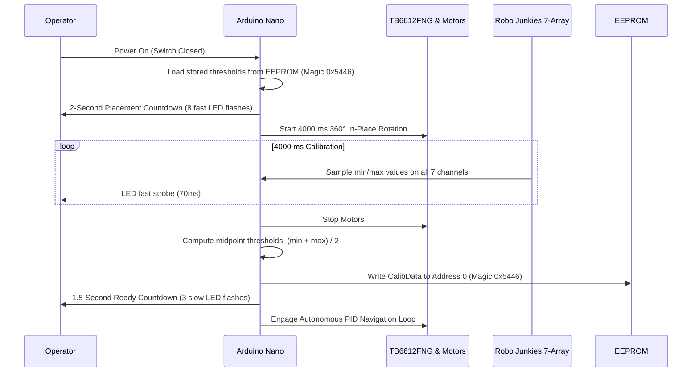

# Line-Follower Robot — Technical Specifications & Operations Manual

An authoritative engineering specification and operational manual for the high-speed autonomous line-follower and maze-solving robot driven by an **Arduino Nano**, **Robo Junkies 7-Array Analog Sensor**, and **TB6612FNG Dual H-Bridge Motor Driver**.

---

## 1. System Architecture & Overview

### 1.1 High-Level Architecture

```mermaid
graph TD
    subgraph Power ["Power Distribution Subsystem"]
        BATT["6V Regulated Battery Supply"]
        REG["5V Logic Regulator / USB"]
        GND["Common Ground Bus"]
    end

    subgraph Controller ["Processing Unit"]
        NANO["Arduino Nano (ATmega328P @ 16MHz)"]
        EEPROM["Internal EEPROM (Calib Data 0x5446)"]
        LED["D13 Status / Junction LED"]
    end

    subgraph Sensing ["Perception Subsystem"]
        SENSOR["Robo Junkies 7-Array Analog Sensor"]
        S_CH["Analog Channels A0–A6 (S1–S7)"]
    end

    subgraph Actuation ["Drive & Motion Subsystem"]
        TB["TB6612FNG Motor Driver (VM: 6V, VCC: 5V)"]
        MR["Right N20 Motor (6V, 300 RPM)"]
        ML["Left N20 Motor (6V, 300 RPM)"]
    end

    BATT -->|VM: 6V| TB
    REG -->|VCC: 5V| NANO
    REG -->|VCC: 5V| TB
    REG -->|VCC: 5V| SENSOR
    GND --- NANO
    GND --- TB
    GND --- SENSOR

    SENSOR -->|A0–A6| NANO
    NANO -->|D3, D4, D5 (PWMA)| TB
    NANO -->|D7, D9, D6 (PWMB)| TB
    NANO -->|D8 (STBY)| TB
    NANO --> LED
    NANO <--> EEPROM

    TB -->|AO1, AO2| MR
    TB -->|BO1, BO2| ML
```

### 1.2 System Specifications

| Parameter | Specification | Notes |
|---|---|---|
| **Robot Type** | Autonomous Line Follower / Maze Solver | Differential drive, closed-loop PID control |
| **Main Controller** | Arduino Nano (ATmega328P @ 16 MHz) | 5V logic level |
| **Perception Array** | Robo Junkies 7-Array Analog Sensor | Phototransistor/IR reflectance array |
| **Motor Driver** | TB6612FNG Dual H-Bridge IC | MOSFET-based, low voltage drop, PWM capable |
| **Actuators** | 2 × N20 Micro Metal Gearmotors | 6V rated, 300 RPM nominal speed |
| **Chassis Total Length** | 21 cm | Front sensor tip to rear chassis boundary |
| **Line Polarity** | Black line on white surface (Default) | Invertible in firmware (`BLACK_LINE = true/false`) |
| **Junction Algorithm** | Right-Hand Rule (R-S-L-U Priority) | Right $\rightarrow$ Straight $\rightarrow$ Left $\rightarrow$ U-Turn |
| **Wireless Module** | None | Fully self-contained autonomous operation |

---

## 2. Complete Electrical Pinout & Wiring

### 2.1 Arduino Nano Master Pin Assignment

| Arduino Pin | Hardware Capability | Connected Device & Pin | Signal Function | Active State / Logic |
|---|---|---|---|---|
| **A0** | Analog In / Digital I/O | Robo Junkies Sensor **S1** | Leftmost sensor channel | Analog input (0–1023) |
| **A1** | Analog In / Digital I/O | Robo Junkies Sensor **S2** | Left-mid outer sensor | Analog input (0–1023) |
| **A2** | Analog In / Digital I/O | Robo Junkies Sensor **S3** | Left-mid inner sensor | Analog input (0–1023) |
| **A3** | Analog In / Digital I/O | Robo Junkies Sensor **S4** | **Center guidance sensor** | Analog input (0–1023) |
| **A4** | Analog In / Digital I/O | Robo Junkies Sensor **S5** | Right-mid inner sensor | Analog input (0–1023) |
| **A5** | Analog In / Digital I/O | Robo Junkies Sensor **S6** | Right-mid outer sensor | Analog input (0–1023) |
| **A6** | **Analog In Only** | Robo Junkies Sensor **S7** | Rightmost sensor channel | Analog input (0–1023) |
| **D3** | PWM (OC2B) / Digital I/O | TB6612FNG **AIN1** | Right Motor Direction In 1 | HIGH/LOW logic |
| **D4** | Digital I/O | TB6612FNG **AIN2** | Right Motor Direction In 2 | HIGH/LOW logic |
| **D5** | **Hardware PWM (OC0B)** | TB6612FNG **PWMA** | Right Motor Speed Control | 8-bit PWM (0–255) |
| **D6** | **Hardware PWM (OC0A)** | TB6612FNG **PWMB** | Left Motor Speed Control | 8-bit PWM (0–255) |
| **D7** | Digital I/O | TB6612FNG **BIN1** | Left Motor Direction In 1 | HIGH/LOW logic |
| **D8** | Digital I/O | TB6612FNG **STBY** | Driver Standby Enable | HIGH = Enabled, LOW = High-Z |
| **D9** | PWM (OC1A) / Digital I/O | TB6612FNG **BIN2** | Left Motor Direction In 2 | HIGH/LOW logic |
| **D13** | Built-in LED (SCK) | Onboard LED | Junction & Calibration indicator | HIGH = On, LOW = Off |
| **5V** | Regulated Output / Input | Sensor VCC, Driver VCC | Logic Power Rail | 5.0 V DC |
| **GND** | System Ground | Common Ground | Reference ground bus | 0 V common |

> [!IMPORTANT]
> **A6 Limitation:** On the ATmega328P (TQFP package), pin **A6** is wired strictly to the ADC multiplexer. It does **not** contain digital input buffers or output drivers. It must be read using `analogRead(A6)` and cannot be used with `digitalRead()`, `digitalWrite()`, or `pinMode()`.

---

## 3. Sensor Subsystem: Robo Junkies 7-Array

### 3.1 Sensor Array Layout & Weights

The 7-channel reflectance array provides lateral line displacement information. Each sensor channel is assigned an integer geometric weight relative to the robot's centerline ($S4 = 0$):

```
       [ Left Wing ]                 [ Center ]                 [ Right Wing ]
          S1       S2       S3           S4           S5       S6       S7
         (A0)     (A1)     (A2)         (A3)         (A4)     (A5)     (A6)
Bit:      6        5        4            3            2        1        0
Weight: -3000    -2000    -1000          0         +1000    +2000    +3000
```

### 3.2 Detection Logic & Error Calculation

1. **Thresholding:**
   $$\text{isOnLine}(i) = \begin{cases} \text{raw}_i > \text{threshold}_i & \text{if } \text{BLACK\_LINE} = \text{true} \\ \text{raw}_i < \text{threshold}_i & \text{if } \text{BLACK\_LINE} = \text{false} \end{cases}$$
2. **Bitmask Register:**
   $$\text{Pattern} = \sum_{i=0}^{6} (\text{isOnLine}(i) \ll (6 - i))$$
3. **Continuous Weighted Center-of-Mass Error:**
   $$\text{Error} = \frac{\sum_{i=0}^{6} \text{ActiveVal}_i \times \text{Weight}_i}{\sum_{i=0}^{6} \text{ActiveVal}_i}$$
   where $\text{ActiveVal}_i = |\text{raw}_i - \text{threshold}_i|$.
4. **Deadband Filter:** If $|\text{Error}| < 40$, the error is rounded to $0$ to eliminate jitter around the centerline.

---

## 4. Actuation Subsystem: TB6612FNG & N20 Motors

### 4.1 TB6612FNG Truth Table

| STBY | IN1 (D3 / D7) | IN2 (D4 / D9) | PWM (D5 / D6) | Out 1 / Out 2 | Operational Mode |
|:---:|:---:|:---:|:---:|:---:|---|
| **H** | **H** | **L** | **PWM** | $H / L$ | **Forward Motion** (Speed governed by PWM duty cycle) |
| **H** | **L** | **H** | **PWM** | $L / H$ | **Reverse Motion** (Speed governed by PWM duty cycle) |
| **H** | **L** | **L** | **X** | High-Z | **Coast** (Inertial deceleration) |
| **H** | **H** | **H** | **X** | $L / L$ | **Short Brake** (Dynamic counter-EMF damping) |
| **L** | **X** | **X** | **X** | High-Z | **Standby** (Ultra-low power shutdown mode) |

### 4.2 Motor Channels & Polarity Mapping

| Subsystem | Driver Inputs | Driver Outputs | Connected Actuator | Inversion Flag in Code |
|---|---|---|---|---|
| **Right Motor** | AIN1 (D3), AIN2 (D4), PWMA (D5) | AO1, AO2 | Right N20 Motor (6V 300 RPM) | `INVERT_RIGHT_MOTOR = false` |
| **Left Motor** | BIN1 (D7), BIN2 (D9), PWMB (D6) | BO1, BO2 | Left N20 Motor (6V 300 RPM) | `INVERT_LEFT_MOTOR = false` |

> [!TIP]
> If a motor spins opposite to the intended forward direction, either flip the motor output leads (AO1/AO2 or BO1/BO2) or set the corresponding inversion flag to `true` in firmware.

---

## 5. Power Distribution & Ground Architecture

### 5.1 Power Routing Schematic

```
[ 6V Regulated Motor Battery / Buck ] ───────────────> TB6612FNG VM (Motor Power)
[ 5V Regulated Logic Supply ] ─────────┬─────────────> Arduino Nano 5V
                                       ├─────────────> TB6612FNG VCC (Logic Power)
                                       └─────────────> Robo Junkies Sensor VCC

[ Common Ground Bus ] ─────────────────┴─────────────> Tied to Arduino GND, Driver GND,
                                                       Sensor GND, Battery Negative
```

### 5.2 Critical Power Guidelines
1. **Never power motors from the Arduino 5V regulator:** The ATmega328P on-board linear regulator cannot deliver the high current surges (0.5A–1.5A stall per motor) required by N20 gear motors, which causes brownout resets.
2. **Dedicated Motor Supply (VM):** The TB6612FNG **VM** pin must receive a stable, high-discharge 6V supply.
3. **Common Ground:** All subsystems (Battery, Arduino Nano, TB6612FNG, and Robo Junkies sensor) must share a common ground bus to prevent signal floating and ADC reference distortion.

---

## 6. Mechanical & Kinematic Specifications

| Parameter | Dimension / Value | Engineering Context |
|---|---|---|
| **Total Bot Length** | 21 cm | Front sensor array overhang to rear bumper |
| **Motor Type** | N20 Micro DC Metal Gearmotor | High torque miniature gearhead |
| **Rated Operating Voltage** | 6.0 V DC | Safe operational range: 3.0V – 9.0V |
| **Nominal Output Speed** | 300 RPM @ 6V | Provides balanced linear speed vs torque for maze solving |
| **Drive Architecture** | 2-Wheel Differential Drive | Independent left/right motor speed steering |
| **Support Wheel / Skid** | Front/Rear Low-Friction Castor or Ball Skid | Maintains chassis level and stable pitch |
| **Recommended Sensor Clearance** | 3 mm to 5 mm above track surface | Optimal focal distance for IR phototransistors |
| **Sensor-to-Axle Offset** | Leading cantilever (~10–12 cm) | Gives early junction detection before axle reaches node |

---

## 7. Firmware Architecture & Control Algorithms

### 7.1 PID Speed & Steering Constants

| Constant | Value | Role & Behavioral Function |
|---|:---:|---|
| `BASE_SPEED` | `145` | Nominal cruise speed (PWM range 0–255) |
| `MAX_SPEED` | `210` | Clamped upper ceiling for motor PWM duty cycle |
| `TURN_SPEED` | `125` | In-place spin speed during pivot and 180° turns |
| `INCH_TIME` | `120 ms` | Forward creep time to position drive axle directly over junction node |
| `Kp` | `0.048` | Proportional gain: immediate corrective steering response |
| `Ki` | `0.00005` | Integral gain: eliminates steady-state drift; clamped to $\pm 1500$ |
| `Kd` | `0.22` | Derivative gain: damps overshoot and prevents high-speed oscillation |

$$\text{Correction} = K_p \times \text{Error} + K_i \times \int \text{Error} \, dt + K_d \times \frac{d(\text{Error})}{dt}$$
$$\text{Speed}_{\text{Left}} = \text{constrain}(\text{BASE\_SPEED} + \text{Correction}, -\text{MAX\_SPEED}, \text{MAX\_SPEED})$$
$$\text{Speed}_{\text{Right}} = \text{constrain}(\text{BASE\_SPEED} - \text{Correction}, -\text{MAX\_SPEED}, \text{MAX\_SPEED})$$

### 7.2 6-Reading Data Protection & Anti-Jitter Filter

To eliminate single-cycle optical glitches from floor reflections or tape seams:
1. **Circular Buffer:** Stores the last 6 consecutive readings of `error` and `pattern`.
2. **Outlier Rejection:** If the deviation between the current raw error and the 6-sample moving average exceeds $\pm 1800$, it is clamped to $\pm 1200$.
3. **Error Smoothing:** The PID controller steering input uses the 6-sample moving average, guaranteeing smooth, twitch-free navigation.
4. **Junction Vote Confirmation:** An intersection trigger requires $\ge 2$ positive confirmations in recent history (`junctionSupported = true`).

### 7.3 Maze Navigation Decision Hierarchy (Right-Hand Rule)

When an intersection is validated, the robot follows a strict priority and precision stopping procedure:

```
[ Intersection Detected ]
          │
          ▼
   [ Inch Forward 120 ms ]       --> Positions drive axle directly over node
          │
          ▼
[ Active Counter-Brake 25 ms ]   --> Eliminates forward momentum
          │
          ▼
 [ Full Stop & Triple-Strobe ]   --> Settle pause + 3 rapid blinks (~135ms) to signal node
          │
          ├──> 1. Right Branch Available? ──> Precision Pivot Right (Priority 1)
          │
          ├──> 2. Straight Path Exists?   ──> Drive Straight (Priority 2)
          │
          ├──> 3. Left Branch Available?  ──> Precision Pivot Left (Priority 3)
          │
          └──> 4. All White / No Exit?    ──> 360° Search & Stop if Not Found (Priority 4)
```

- **S4 Precision 90° Turn:** During pivots, the perception subsystem focuses exclusively on locking center sensor **S4** (pin A3) onto the incoming branch. The moment S4 confirms line acquisition, an active counter-torque reverse burst (28 ms at half-speed) snaps the robot onto the new heading without inertial overshoot.
- **Consecutive Junction Re-Arming:** To reliably handle junctions in tight succession (within 5–10 cm of each other), the re-arming logic uses a dual condition: outer sensors ($S1, S2, S6, S7$) cleared with $> 15\text{ ms}$ debounce, OR a failsafe timer ($> 120\text{ ms}$) while middle sensor S4 is securely tracking the line.
- **360° Differential Line Search & Failsafe Stop:** When all sensors detect white continuously for $> 100\text{ ms}$ (filtering tape seams), the robot initiates a 360° differential spin search towards the last-tracked error side. If the line is re-acquired during the sweep, it locks S4 and resumes PID tracking. If the full 360° rotation completes without detecting a line, motors are immediately cut (`setMotors(0, 0)`) and an alert heartbeat LED signals a safe stop state.

### 7.4 Online Adaptive Calibration using Sliding Window

To compensate for gradual changes in surface reflectivity, thermal drift, and battery voltage degradation:
1. **3-Sample Sliding Window:** Keeps the last 3 samples (`rawHistory[i][0..2]`) per channel to detect signal stability ($|\Delta| \le 30$ counts) and reject sudden edges or spikes.
2. **Safety Gate (`calibrationAllowed`):**
   - Active only when 1 to 3 sensors track the line.
   - Frozen on junctions (`hasLeft`, `hasRight`, `hasCross`), line loss (`allWhite`), or during post-turn debounce ($< 250\text{ ms}$).
   - Frozen when lateral tracking error $> 800$.
3. **Bounded EMA Adaptation:** Updates min/max envelopes with an Exponential Moving Average ($\alpha = 0.01$).
4. **Hard Guards:** Thresholds are clamped to $\pm 120$ counts of initial calibration, with minimum contrast span $\ge 160$ counts. Zero EEPROM writes during navigation loop to protect flash endurance.

---

## 8. Calibration & Operating Lifecycle



---

## 9. Pre-Flight Checklist & Troubleshooting Matrix

### 9.1 Pre-Flight Verification Checklist

- [ ] **Sensor Board VCC:** Ensure the sensor board is rated for 5V logic.
- [ ] **Common Ground:** Verify $0\,\Omega$ resistance between battery negative, Arduino GND, sensor GND, and TB6612FNG GND.
- [ ] **Isolated Motor Power:** Verify TB6612FNG **VM** is connected directly to the 6V battery rail, **not** to the Arduino 5V pin.
- [ ] **Free Wheel Spin:** Keep robot wheels elevated during initial power-on to confirm motor spin directions.
- [ ] **Calibration Placement:** Place robot centered over the line before power-on so the 360° spin samples both black line and white background.

### 9.2 Troubleshooting Guide

| Symptom | Probable Cause | Corrective Action |
|---|---|---|
| **Robot oscillates violently on straight lines** | $K_p$ or $K_d$ gain too high | Decrease $K_p$ (try $0.038$) or increase $K_d$ slightly to damp oscillation. |
| **Robot turns opposite to line at start** | Motor polarity inverted | Swap motor leads (AO1/AO2 or BO1/BO2) or set `INVERT_LEFT_MOTOR` / `INVERT_RIGHT_MOTOR` in code. |
| **Misses 90° junctions** | Axle not reaching node before pivot | Increase `INCH_TIME` by $10\text{–}15\text{ ms}$ in `LineFollowerPID.ino`. |
| **Over-rotates past line during turns** | Braking delay insufficient | Check active counter-torque braking duration (`delay(25)` in `pivot()`). |
| **False dead-end triggers on track seams** | Seam optical debounce too short | Increase `lostLineStart` timeout from $120\text{ ms}$ to $150\text{ ms}$. |
| **Calibration values don't save across reboots** | EEPROM write failure or corrupted magic | Verify EEPROM address 0 contains magic key `0x5446`. |
