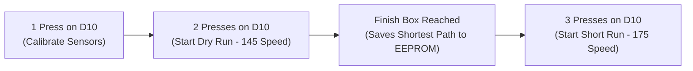

# Line-Follower & Maze-Solver Robot — Technical Specifications & Operations Manual

An authoritative engineering specification and operational manual for the autonomous line-follower and Graph-DFS maze-solving robot driven by an **Arduino Nano**, **Robo Junkies 7-Array Analog Sensor**, **TB6612FNG Dual H-Bridge Motor Driver**, and **Pin D10 Mode Control Button**.

---

## 1. System Architecture & Overview

### 1.1 High-Level Architecture

```mermaid
graph TD
    subgraph Power ["Power Distribution Subsystem"]
        BATT["6V Regulated Battery Supply"]
        REG["5V Logic Regulator / USB"]
        GND["Common Ground Bus"]
    end

    subgraph Controller ["Processing & User Interface"]
        NANO["Arduino Nano (ATmega328P @ 16MHz)"]
        EEPROM["Internal EEPROM (Calib 0x5446 + Path 0x5046)"]
        BTN["D10 Push-Button (INPUT_PULLUP)"]
        LED["D13 Status / Junction LED"]
    end

    subgraph Sensing ["Perception Subsystem"]
        SENSOR["Robo Junkies 7-Array Analog Sensor"]
        S_CH["Analog Channels A0–A6 (S1–S7)"]
    end

    subgraph Actuation ["Drive & Motion Subsystem"]
        TB["TB6612FNG Motor Driver (VM: 6V, VCC: 5V)"]
        MR["Right N20 Motor (6V, 300 RPM)"]
        ML["Left N20 Motor (6V, 300 RPM)"]
    end

    BATT -->|VM: 6V| TB
    REG -->|VCC: 5V| NANO
    REG -->|VCC: 5V| TB
    REG -->|VCC: 5V| SENSOR
    GND --- NANO
    GND --- TB
    GND --- SENSOR
    GND --- BTN

    SENSOR -->|A0–A6| NANO
    BTN -->|D10 Active LOW| NANO
    NANO -->|D3, D4, D5 (PWMA)| TB
    NANO -->|D7, D9, D6 (PWMB)| TB
    NANO -->|D8 (STBY)| TB
    NANO --> LED
    NANO <--> EEPROM

    TB -->|AO1, AO2| MR
    TB -->|BO1, BO2| ML
```

### 1.2 System Specifications

| Parameter | Specification | Notes |
|---|---|---|
| **Robot Type** | Autonomous Line Follower & Graph-DFS Maze Solver | Dual-profile closed-loop PID (`Dry Run = 145`, `Final Run = 175`) |
| **Main Controller** | Arduino Nano (ATmega328P @ 16 MHz) | 5V logic level |
| **Perception Array** | Robo Junkies 7-Array Analog Sensor | Phototransistor/IR reflectance array (`A0–A6`) |
| **Motor Driver** | TB6612FNG Dual H-Bridge IC | MOSFET-based, low voltage drop, PWM capable |
| **Actuators** | 2 × N20 Micro Metal Gearmotors | 6V rated, 300 RPM nominal speed |
| **Control Input** | Push-Button on **Pin D10** (`PIN_BTN = 10`) | `1 Press` = Calibrate, `2 Presses` = Dry Run, `3 Presses` = Short Run |
| **Chassis Total Length** | 21 cm | Front sensor tip to rear chassis boundary |
| **Line Polarity** | Black line on white surface (Default) | Invertible in firmware (`BLACK_LINE = true/false`) |
| **Exploration Algorithm** | Loop-Aware Right-Priority Graph-DFS | `Right > Straight > Left > Back` preferring unvisited edges + 4-R cycle breaker |
| **Shortest Path Engine** | Unified $\Delta H$ Stack Pruning + Dijkstra | Solves both dead-ends (`RBR->S`, `RBS->L`, etc.) and multi-path loops |
| **Finish Detection** | 3 Consecutive Back-to-Back T-Junctions | Triggered when `tJunctionCount >= 3` within `maxTJunctionGap` |

---

## 2. Complete Electrical Pinout & Wiring

### 2.1 Arduino Nano Master Pin Assignment

| Arduino Pin | Hardware Capability | Connected Device & Pin | Signal Function | Active State / Logic |
|---|---|---|---|---|
| **A0** | Analog In / Digital I/O | Robo Junkies Sensor **S1** | Leftmost sensor channel | Analog input (0–1023) |
| **A1** | Analog In / Digital I/O | Robo Junkies Sensor **S2** | Left-mid outer sensor | Analog input (0–1023) |
| **A2** | Analog In / Digital I/O | Robo Junkies Sensor **S3** | Left-mid inner sensor | Analog input (0–1023) |
| **A3** | Analog In / Digital I/O | Robo Junkies Sensor **S4** | **Center guidance sensor** | Analog input (0–1023) |
| **A4** | Analog In / Digital I/O | Robo Junkies Sensor **S5** | Right-mid inner sensor | Analog input (0–1023) |
| **A5** | Analog In / Digital I/O | Robo Junkies Sensor **S6** | Right-mid outer sensor | Analog input (0–1023) |
| **A6** | **Analog In Only** | Robo Junkies Sensor **S7** | Rightmost sensor channel | Analog input (0–1023) |
| **D3** | PWM (OC2B) / Digital I/O | TB6612FNG **AIN1** | Right Motor Direction In 1 | HIGH/LOW logic |
| **D4** | Digital I/O | TB6612FNG **AIN2** | Right Motor Direction In 2 | HIGH/LOW logic |
| **D5** | **Hardware PWM (OC0B)** | TB6612FNG **PWMA** | Right Motor Speed Control | 8-bit PWM (0–255) |
| **D6** | **Hardware PWM (OC0A)** | TB6612FNG **PWMB** | Left Motor Speed Control | 8-bit PWM (0–255) |
| **D7** | Digital I/O | TB6612FNG **BIN1** | Left Motor Direction In 1 | HIGH/LOW logic |
| **D8** | Digital I/O | TB6612FNG **STBY** | Driver Standby Enable | HIGH = Enabled, LOW = High-Z |
| **D9** | PWM (OC1A) / Digital I/O | TB6612FNG **BIN2** | Left Motor Direction In 2 | HIGH/LOW logic |
| **D10** | Digital I/O (`INPUT_PULLUP`) | Mode Push-Button (`PIN_BTN`) | Mode Selection & Emergency Stop | `LOW` = Pressed (tied to GND) |
| **D13** | Built-in LED (SCK) | Onboard LED (`PIN_LED`) | Junction, Standby & Mode indicator | HIGH = On, LOW = Off |
| **5V** | Regulated Output / Input | Sensor VCC, Driver VCC | Logic Power Rail | 5.0 V DC |
| **GND** | System Ground | Common Ground | Reference ground bus | 0 V common |

> [!IMPORTANT]
> **A6 Limitation:** On the ATmega328P (TQFP package), pin **A6** is wired strictly to the ADC multiplexer. It must be read using `analogRead(A6)` and cannot be used with `digitalRead()`.

---

## 3. Sensor Subsystem: Robo Junkies 7-Array

### 3.1 Sensor Array Layout & Weights

Each sensor channel is assigned an integer geometric weight relative to the robot's centerline ($S4 = 0$):

```
       [ Left Wing ]                 [ Center ]                 [ Right Wing ]
          S1       S2       S3           S4           S5       S6       S7
         (A0)     (A1)     (A2)         (A3)         (A4)     (A5)     (A6)
Bit:      6        5        4            3            2        1        0
Weight: -3000    -2000    -1000          0         +1000    +2000    +3000
```

### 3.2 Detection Logic & Error Calculation (`readSensors`)

1. **Thresholding (`isOnLine`):**
   $$\text{isOnLine}(i) = \begin{cases} \text{raw}_i > \text{sensorThreshold}_i & \text{if } \text{BLACK\_LINE} = \text{true} \\ \text{raw}_i < \text{sensorThreshold}_i & \text{if } \text{BLACK\_LINE} = \text{false} \end{cases}$$
2. **Bitmask Register:**
   $$\text{pattern} = \sum_{i=0}^{6} (\text{isOnLine}(i) \ll (6 - i))$$
3. **Continuous Weighted Center-of-Mass Error:**
   $$\text{continuousError} = \frac{\sum_{i=0}^{6} \text{activeVal}_i \times \text{SENSOR\_WEIGHTS}_i}{\sum_{i=0}^{6} \text{activeVal}_i}$$
   where $\text{activeVal}_i = |\text{raw}_i - \text{sensorThreshold}_i|$.
4. **Deadband & Anomaly Filter:**
   - If $|\text{continuousError}| < 40$, error is clamped to $0$.
   - Optical anomalies `0b1000001` and `0b1010101` are rejected and return `lastError`.

---

## 4. Actuation Subsystem: TB6612FNG & N20 Motors

### 4.1 TB6612FNG Truth Table (`setMotor` / `setMotors`)

| STBY | IN1 (D3 / D7) | IN2 (D4 / D9) | PWM (D5 / D6) | Out 1 / Out 2 | Operational Mode |
|:---:|:---:|:---:|:---:|:---:|---|
| **H** | **H** | **L** | **PWM** | $H / L$ | **Forward Motion** (`speed > 0`) |
| **H** | **L** | **H** | **PWM** | $L / H$ | **Reverse Motion** (`speed < 0`) |
| **H** | **L** | **L** | **0** | High-Z | **Stop / Coast** (`speed == 0`) |
| **L** | **X** | **X** | **X** | High-Z | **Standby** |

---

## 5. Firmware Architecture & Dual-Mode Control Profiles

### 5.1 Dual Mode-Specific Speed, Timing & PID Profiles (`applySpeedProfile`)

The firmware automatically switches all speed, PID, filter, braking, and timing parameters depending on whether it is executing the **Dry Run (`MODE_DRY_RUN`)** or the **Final Shortest-Path Run (`MODE_SPEED_RUN`)**:

| Parameter | Dry Run (`MODE_DRY_RUN`) | Final Run (`MODE_SPEED_RUN`) | Engineering Purpose |
| :--- | :---: | :---: | :--- |
| **`baseSpeed`** | `145` | **`175`** | Nominal straight-line cruise PWM |
| **`maxSpeed`** | `210` | **`240`** | Upper PWM clamp during steering corrections |
| **`turnSpeed`** | `125` | **`145`** | Differential pivot speed for 90° and 180° turns |
| **`Kp`** | `0.048` | **`0.058`** | Proportional gain ($\text{Kp} \times 3000 \approx \text{baseSpeed}$) |
| **`Ki`** | `0.00005` | **`0.00004`** | Integral gain |
| **`Kd`** | `0.22` | **`0.28`** | Derivative damping gain |
| **`integralClamp`** | `±1500` | **`±1200`** | Anti-windup integral accumulator limit |
| **`activeHistoryLen`** | `6` | **`5`** | Moving-average window length in `applyDataProtection()` |
| **`slewDevMax` / `slewStep`** | `1800` / `1200` | **`2000` / `1400`** | Single-sample outlier slew-rate limiter |
| **`inchTime` / `inchBrakeMs`** | `220 ms` / `25 ms` | **`180 ms` / `30 ms`** | Forward inching duration & reverse counter-brake pulse |
| **`pivot()` Timings** | `100 / 150 / 1200 / 30 / 30 ms` | **`85 / 130 / 1000 / 35 / 25 ms`** | Unstick / Clear S4 / Acquire S4 / Reverse Brake / Settle |
| **`straightClearMs`** | `60 ms` | **`50 ms`** | Forward drive boost in `driveStraightPastJunction()` |
| **`deadEndTimeoutMs`** | `100 ms` | **`80 ms`** | `allWhite` duration before triggering 180° turnaround |
| **`minJunctionDebounce` / `rearmFallbackMs`** | `15 ms` / `120 ms` | **`12 ms` / `95 ms`** | Post-junction re-arming gates |
| **`maxTJunctionGap`** | `750 ms` | **`650 ms`** | Maximum window between consecutive T-junctions for Finish Box |
| **`sweep360Time` / `sweepBrakeMs`** | `3800 ms` / `28 ms` | **`3300 ms` / `32 ms`** | 360° line search timeout and lock counter-brake |
| **`odomDivisor`** | `40 ms/unit` | **`33 ms/unit`** | Time-odometry divisor for graph coordinate mapping |

### 5.2 Graph-DFS Exploration & Shortest-Path Solver

1. **Compass Heading & Time-Odometry Graph (`nodes[28]`):**
   - Tracks drift-free compass heading `currentHeading` $\in \{0=\text{N}, 1=\text{E}, 2=\text{S}, 3=\text{W}\}$ and estimated grid coordinates `(curX, curY)` using elapsed segment travel time `segCost = (millis() - segmentStartTime) / odomDivisor`.
   - `findOrCreateNode()` matches revisited junctions within `SNAP_RADIUS = 12` when topology overlaps, snapping `(curX, curY)` to cancel drift and linking bidirectional weighted edges.
   - After any 180° dead-end turnaround (`recordDeadEnd()`), `lastTurnWasBack = true` guarantees the next junction snaps directly back to `currentNode`.
2. **Loop-Safe Right-Priority Selection:**
   - At every junction in `MODE_DRY_RUN`, available branches are evaluated in **`Right > Straight > Left`** order:
     - **Pass 1:** Selects the highest-priority **unvisited** exit (`visitedMask`).
     - **Pass 2:** Falls back to standard `R > S > L` if all exits have been visited.
     - **Cycle-Breaker Guard:** If `consecutiveRightTurns >= 4` ($+360^\circ$ loop) and Straight or Left is available, Right is blocked to break out of closed island loops.
3. **In-Flight Reduction (`recordAndReduceTurn` & `collapseBStack`) + Dijkstra (`computeShortestPath`):**
   - Collapses dead-end `'B'` sequences (`RBR -> S`, `RBS -> L`, `SBR -> L`, `LBR -> B`, `RBL -> B`, `SBS -> B`) and revisited-node sub-loops in real time using `dirsToTurn(origIn, curOut)`.
   - At the Finish Box, `computeShortestPath()` extracts the pruned stack up to `preFinishStackLen` (ignoring the Finish Box bars themselves), runs Dijkstra across `nodes[]` from `Node 0` to `preFinishNode` to upgrade `shortestPath[]` if a faster multi-path shortcut exists, and persists the result to `EEPROM` (`StoredPath`, magic `0x5046`).

---

## 6. How to Operate the Robot (`PIN_BTN = D10`)

When the robot is powered on or stopped in Standby (`waitForButtonCommand`), the onboard LED (`D13`) gives a short heartbeat flash every `0.8 seconds`:



### Step-by-Step Arena Operation

1. **`1 Press` — Calibrate Sensors (`calibrateSensors`):**
   - Place the robot over the black line and white floor, then press `D10` **1 time**.
   - After `0.4s`, the robot spins in place for `4 seconds` (`CALIB_SPIN_SPEED = 125`) while flashing `D13`, saves the calibrated thresholds to `EEPROM` (`0x5446`), and returns to Standby.
2. **`2 Presses` — Start Dry Run (`MODE_DRY_RUN`, Base Speed `145`):**
   - Align the robot on the **Start Line** and press `D10` **2 times** (or press **1 time** immediately after calibration).
   - `D13` blinks **2 times**, waits `0.4s`, loads the `145` Dry-Run profile, and explores the maze.
   - Upon detecting **3 consecutive T-junctions** at the Finish Box, the robot halts, computes and saves `shortestPath[]` to `EEPROM`, blinks `D13` **6 times**, and enters Standby.
3. **`3 Presses` — Start Final Short Run (`MODE_SPEED_RUN`, Base Speed `175`):**
   - Place the robot back on the **Start Line** and press `D10` **3 times** (or press **1 time** right after the Dry Run finishes).
   - `D13` blinks **3 times**, waits `0.4s`, loads the `175` Final-Run profile, and executes `shortestPath[]` directly to the Finish Box.
4. **In-Run Emergency Stop / Reset:**
   - Pressing `D10` at any time while the robot is moving immediately stops the motors and returns to Standby (`waitForButtonCommand`).
   - Because both calibration and `shortestPath[]` are stored in `EEPROM`, you can power-cycle the robot at any time and press `D10` **3 times** to re-run the saved shortest path directly.
